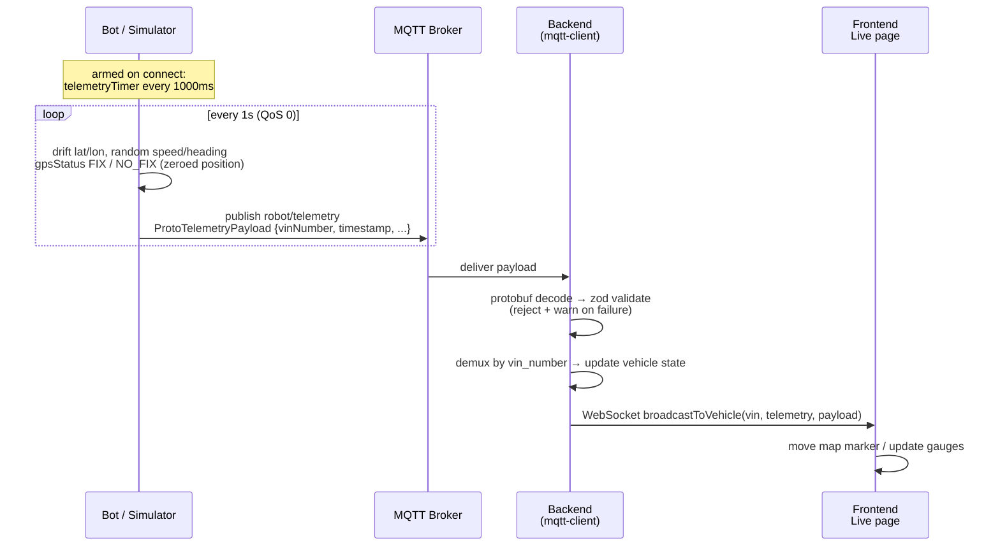
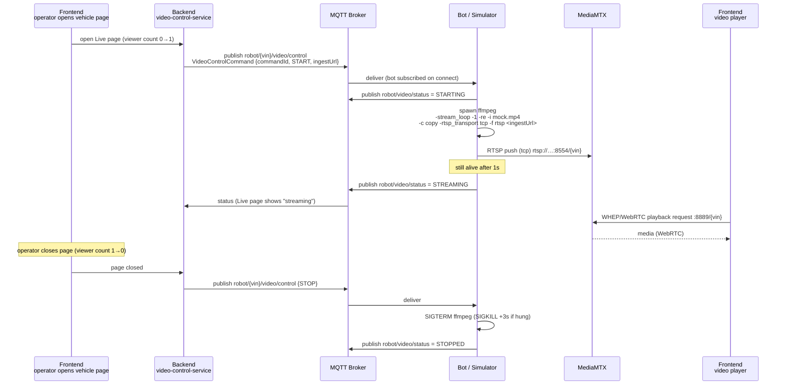

# Telemetry & Video Streaming Flow Diagrams

Flow diagrams for the two real-time data paths in the RoshAI Control Tower.
Sources: `tools/bot-simulator.ts`, `shared/src/mqtt/topics.ts`,
`backend/src/index.ts`, `backend/src/lib/socket-server.ts`,
`docs/video-streaming-contract.html`.

> Topics shown are the **current multi-vehicle scheme** (`robot/{vin}/...`).
> The older `robot/AUTO/...` names in the video contract HTML are superseded.

---

## 1. Architecture overview

```mermaid
flowchart LR
    subgraph BotSide["Bot (real Jetson / bot-simulator)"]
        CAM[Camera / mock_vehicle.mp4]
        FFMPEG[ffmpeg re-stream]
        BPUB[MQTT publish]
        BSUB[MQTT subscribe]
    end

    subgraph Broker["MQTT Broker (Mosquitto)"]
        T1[robot/telemetry<br/>robot/stop-event<br/>robot/handshake/request<br/>robot/video/status]
        T2[robot/heartbeat]
        T3[robot/{vin}/command<br/>robot/{vin}/video/control<br/>robot/{vin}/handshake/response]
    end

    subgraph Backend["Backend (Node)"]
        MC[mqtt-client<br/>decode + validate]
        DEMUX[demux by payload vin_number]
        SS[(socket-server<br/>WebSocket)]
        VCS[video-control-service<br/>viewer-count 0↔1]
        DB[(Database)]
    end

    subgraph Media["MediaMTX"]
        RTSP[RTSP ingest :8554]
        WHEP[WHEP/WebRTC playback :8889]
    end

    FE[Frontend Live page]

    BPUB -->|protobuf QoS 0/1| T1
    T1 --> MC --> DEMUX --> SS --> FE
    DEMUX --> DB

    VCS -->|START / STOP| T3 --> BSUB
    BPUB -->|video status| T1

    CAM --> FFMPEG -->|RTSP push tcp| RTSP --> WHEP --> FE

    SS -->|viewer count 0→1| VCS
    T2 -.->|500ms liveness| BSUB
```

**Key idea:** telemetry and video are *separate planes*. Telemetry is small
protobuf over MQTT; video is bulk media pushed over RTSP and never touches
MQTT — MQTT only carries the tiny start/stop control signal.

---

## 2. Telemetry flow (sequence)



Notes:

- **QoS 0** — a missed reading is fine, next one comes in 1s.
- The **timestamp field inside the payload** is the bot's clock; backend
  receipt time minus payload time = end-to-end freshness (the load-test SLO).
- All bots publish to the **same** `robot/telemetry` topic; the VIN lives in
  the payload, not the topic.
- Complementary backend→bot liveness path: backend broadcasts
  `robot/heartbeat` every 500ms; the bot's watchdog fires a network-loss
  stop-event after 3 missed intervals (1.8s).

---

## 3. Video streaming flow (sequence)

Viewer-driven: the stream only exists while someone is watching.



Failure reporting: unexpected ffmpeg exit → `robot/video/status = ERROR`
with the exit code and last ~300 chars of stderr; missing mock video → ERROR
immediately (mirrors the real bot's "camera not found").

---

## 4. ASCII quick reference

```
TELEMETRY (always on, 1 Hz per bot, QoS 0)
┌────────────┐   robot/telemetry    ┌──────────┐   WebSocket    ┌───────────┐
│ Bot (×N)   │ ───────────────────▶ │ Backend  │ ─────────────▶ │ Frontend  │
│ protobuf   │  vin in payload      │ decode → │ broadcast      │ Live page │
└────────────┘                      │ validate │ per vin        └───────────┘
        ▲                           └──────────┘
        │ robot/heartbeat (500ms, fleet-wide, QoS 0)
        └────── deadman: 3 missed (1.8s) → robot/stop-event (QoS 1)

VIDEO (only while a viewer watches)
┌──────────┐ viewer 0→1 ┌──────────┐ robot/{vin}/video/control ┌────────┐
│ Frontend │ ─────────▶ │ Backend  │ ────────────────────────▶ │ Bot    │
└──────────┘            └──────────┘                           └─┬──────┘
     ▲                              robot/video/status ◀──────────┤ ffmpeg
     │                          (starting/streaming/             │
     │                           stopped/error, QoS 1)            ▼ RTSP push (tcp)
     │                                              ┌──────────────────────┐
     └──────────── WHEP / WebRTC :8889/{vin} ────── │ MediaMTX :8554       │
                                                    └──────────────────────┘
```
